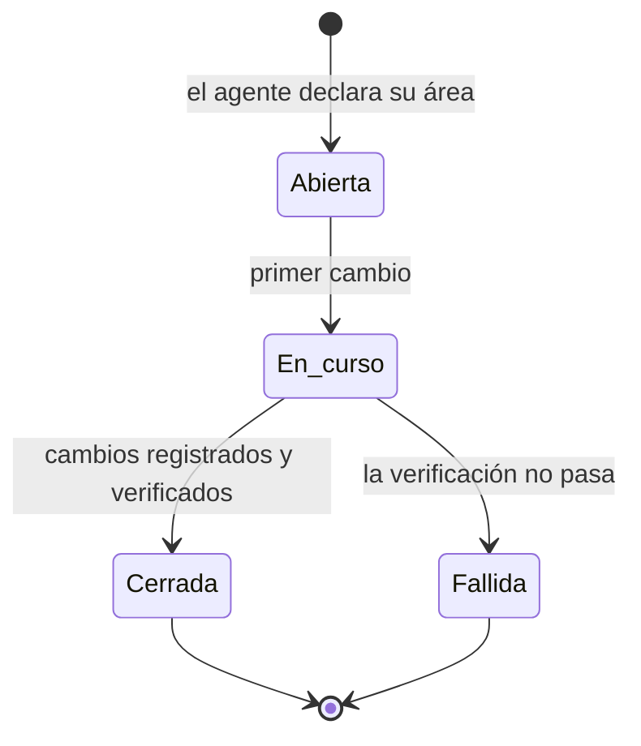

# Bitácora de Sesiones con IA

> [!info] Qué es este documento
> El registro **por sesión de trabajo**: quién la abrió, con qué modelo de IA
> trabajado, qué se tocó y cómo terminó.
>
> [[12.02 Registro de Cambios]] dice *qué* cambió. Este documento dice *quién*
> lo hizo, *con qué herramienta* y *con qué resultado*.

---

## 1. Por qué una bitácora de IA

El proyecto usa IA para producir documentación y, más adelante, código. Eso
tiene dos efectos que hay que poder auditar:

| Efecto | Riesgo | Lo que responde la bitácora |
|---|---|---|
| **El modelo aporta criterio** | Dos modelos distintos toman decisiones distintas ante el mismo pedido | ¿Qué modelo produjo este documento? |
| **El modelo ejecuta cambios** | Un error del modelo se propaga a muchos archivos de una vez | ¿Qué tocó la sesión y con qué resultado? |
| **La escala es alta** | Un humano no puede revisar 95 documentos línea por línea | ¿Cuánto se revisó y qué quedó sin revisar? |

> [!danger] El dato que no se puede recuperar después
> El modelo usado. Ni el historial de Git ni el diff dicen con qué modelo se
> escribió un texto. Si no se registra en el momento, se pierde para siempre.
> Por eso la atribución del modelo se escribe **durante** la sesión, no después.

---

## 2. Ciclo de vida de una sesión



| Estado | Significado | Qué debe tener |
|---|---|---|
| **Abierta** | La sesión existe pero todavía no modificó nada | Fecha, objetivo, área, operador, modelo |
| **En curso** | Está modificando archivos | Lo anterior + archivos tocados hasta ahora |
| **Cerrada** | Terminó bien | Lo anterior + verificación + entradas de registro generadas |
| **Fallida** | Terminó con un error o una verificación rota | Lo anterior + qué falló |

> [!tip] Una sesión que no se cierra bloquea el trabajo
> Si la sesión queda "en curso" para siempre, la siguiente no sabe si puede
> tocar los mismos archivos. Por eso el cierre es explícito y obligatorio, y
> por eso una sesión interrupted por un corte de luz se cierra a mano al
> retomar.

---

## 3. Campos obligatorios

| Campo | Formato | Ejemplo |
|---|---|---|
| **ID** | `SES-AAAA-NNN` | `SES-2026-002` |
| **Inicio** | `YYYY-MM-DD HH:MM (±ZZ)` | `2026-10-22 11:20 (−03)` |
| **Fin** | `YYYY-MM-DD HH:MM (±ZZ)` o `—` | `2026-10-22 12:05 (−03)` |
| **Operador** | Persona que abrió la sesión | `Cesar Benitez` |
| **Herramienta** | Harness y versión | `OpenCode v2.0.32` |
| **Agente** | Modo del agente | `build` |
| **Proveedor** | Identificador del proveedor | `opencode` |
| **Modelo** | Identificador exacto del modelo | `big-pickle` |
| **Variante** | Variante del modelo, si existe | `default` |
| **Objetivo** | Qué se intentó hacer | `Crear la capa de gobierno del cambio` |
| **Área** | Carpeta de la bóveda que se tocó | `12 - Registro de Cambios` |
| **Archivos tocados** | Rutas exactas | ver [[12.02 Registro de Cambios]] |
| **Verificación** | Comando y resultado | `bin/validate-vault.py` → 0 errores |
| **Resultado** | `completado` \| `parcial` \| `fallido` | `completado` |
| **Entradas de registro** | IDs generados | `REG-2026-004` |
| **Pendiente** | Lo que quedó abierto | `—` |

### 3.1 El modelo se registra completo

La forma canónica es `proveedor/modelo#variante`:

| Se escribe | Correcto |
|---|---|
| `opencode/big-pickle#default` | Sí |
| `opencode/big-pickle` | Sí, si no hay variante |
| `qoder/Qwen3.8-Flash` | Sí, sin variante cuando el entorno no la expone |
| `big-pickle` | Sí, pero se pierde el proveedor |
| `Big Pickle` | No — es el nombre comercial, no el identificador |
| `IA` | No |
| `—` / `no declarado` / `*(completar)*` | **No** — la sesión no se registra así |

> [!danger] No existe la sesión sin modelo
> Una entrada sin identificador de modelo es una sesión sin dueño: no se puede atribuir
> después. Si el agente no lo conoce, **primero lo consigue y si no, lo pregunta**:
>
> | Paso | Cómo |
> |---|---|
> | 1. Buscar en el log del entorno | Qoder: `~/.qoder/logs/sessions/<slug>/<session-uuid>/segments/*.jsonl`, campos `provider` y `model` de los eventos de hook. El transcript de `~/.qoder/projects/…jsonl` **no** sirve: solo trae el alias interno `qfmodel`. Este registro no está garantizado en todas las sesiones |
> | 2. Preguntar al operador | Si el entorno no lo expone, se le pide el `proveedor/modelo#variante` (lo ve en el selector de modelo del cliente) |
> | 3. Recién entonces registrar | `bin/cai-log.py sesion --modelo ...` y `bin/cai-log.py cambio --modelo ...` fallan sin el dato: es la barrera, no se salta |
> | 4. Verificar con la herramienta | `bin/validate-vault.py`, regla `atribución` (ver [[05.09 Herramientas de Gobernanza]] §3.2): ninguna sesión del índice puede quedar sin entrada, ni ninguna entrada sin proveedor o modelo |
>
> Las entradas ya escritas **no se reescriben** ([[12.01 Política de Cambios y Trazabilidad]]
> §5). Si una quedó incompleta, se agrega una entrada nueva que la complete. Es el caso de
> `SES-2026-003`, creada por el plugin con los campos `*(completar)*`: su cierre quedó
> documentado en REG-2026-021 y `SES-2026-015`, y el texto original se conserva.

---

## 4. Índice de sesiones

<!-- SES-INDEX:START -->

| ID | Fecha | Operador | Herramienta | Modelo | Resultado | Entradas |
|---|---|---|---|---|---|---|
| SES-2026-047 | 2026-11-23 | Cesar Benitez | OpenCode v2.4.1 | `opencode-go/hy4-flash-free` | completado | REG-2026-060 |
| SES-2026-046 | 2026-11-19 | Cesar Benitez | OpenCode v2.3.2 | `opencode-go/qwen4-max` | completado | REG-2026-059 |
| SES-2026-045 | 2026-11-19 | Cesar Benitez | OpenCode v2.3.2 | `opencode-go/qwen4-max` | parcial | REG-2026-058 |
| SES-2026-044 | 2026-11-19 | Cesar Benitez | OpenCode v2.3.2 | `opencode-go/qwen4-max` | completado | REG-2026-057 |
| SES-2026-043 | 2026-11-19 | Cesar Benitez | OpenCode v2.3.2 | `opencode-go/qwen4-max` | completado | REG-2026-056 |
| SES-2026-042 | 2026-11-19 | Cesar Benitez | OpenCode v2.3.2 | `opencode-go/qwen4-max` | completado | REG-2026-055 |
| SES-2026-041 | 2026-11-19 | Cesar Benitez | OpenCode v2.3.2 | `opencode-go/qwen4-max` | parcial | REG-2026-054 |
| SES-2026-040 | 2026-11-19 | Cesar Benitez | OpenCode v2.3.2 | `opencode-go/qwen4-max` | parcial | REG-2026-053 |
| SES-2026-039 | 2026-11-19 | Cesar Benitez | OpenCode v2.3.2 | `opencode-go/qwen4-max` | parcial | REG-2026-052 |
| SES-2026-038 | 2026-11-19 | Cesar Benitez | OpenCode v2.3.2 | `opencode-go/qwen4-max` | parcial | REG-2026-051 |
| SES-2026-037 | 2026-11-19 | Cesar Benitez | OpenCode v2.3.2 | `opencode-go/qwen4-max` | completado | REG-2026-050 |
| SES-2026-036 | 2026-11-19 | Cesar Benitez | OpenCode v2.3.2 | `opencode-go/qwen4-max` | parcial | REG-2026-049, REG-2026-050 |
| SES-2026-035 | 2026-11-19 | Cesar Benitez | OpenCode v2.3.2 | `opencode-go/qwen4-max` | completado | REG-2026-048 |
| SES-2026-034 | 2026-11-09 | Cesar Benitez | OpenCode | `opencode/deepseek-v4.1-flash-free#default` | completado | REG-2026-047 |
| SES-2026-033 | 2026-10-27 | Cesar Benitez | Qoder Desktop | `qoder/Qwen3.8-Flash` | completado | REG-2026-040, REG-2026-041, REG-2026-042, REG-2026-043, REG-2026-044, REG-2026-045, REG-2026-046 |
| SES-2026-032 | 2026-10-27 | Cesar Benitez | Qoder Desktop | `qoder/Qwen3.8-Flash` | completado | REG-2026-039 |
| SES-2026-031 | 2026-10-27 | Cesar Benitez | Qoder Desktop | `qoder/Qwen3.8-Flash` | completado | REG-2026-037, REG-2026-038 |
| SES-2026-030 | 2026-10-27 | Cesar Benitez | Qoder Desktop | `qoder/Qwen3.8-Flash` | completado | REG-2026-036 |
| SES-2026-029 | 2026-10-27 | Cesar Benitez | Qoder Desktop | `qoder/Qwen3.8-Flash` | parcial | REG-2026-035 |
| SES-2026-028 | 2026-10-27 | Cesar Benitez | Qoder Desktop | `qoder/Qwen3.8-Flash` | completado | REG-2026-034 |
| SES-2026-027 | 2026-10-27 | Cesar Benitez | Qoder Desktop | `qoder/Qwen3.8-Flash` | parcial | REG-2026-033 |
| SES-2026-026 | 2026-10-27 | Cesar Benitez | OpenCode | `opencode/deepseek-v4.1-flash-free#default` | completado | REG-2026-032 |
| SES-2026-025 | 2026-10-27 | Cesar Benitez | OpenCode | `opencode/deepseek-v4.1-flash-free#default` | completado | REG-2026-031 |
| SES-2026-024 | 2026-10-27 | Cesar Benitez | OpenCode | `opencode/deepseek-v4.1-flash-free#default` | completado | REG-2026-030 |
| SES-2026-023 | 2026-10-24 | Cesar Benitez | OpenCode | `opencode/deepseek-v4.1-flash-free#default` | completado | REG-2026-029 |
| SES-2026-022 | 2026-10-24 | Cesar Benitez | OpenCode | `opencode/deepseek-v4.1-flash-free#default` | completado | REG-2026-028 |
| SES-2026-021 | 2026-10-23 | Cesar Benitez | OpenCode | `opencode/deepseek-v4.1-flash-free#default` | completado | REG-2026-027 |
| SES-2026-020 | 2026-10-23 | Cesar Benitez | Claude Code | `anthropic/claude-sonnet-4-5` | completado | REG-2026-026 |
| SES-2026-019 | 2026-10-23 | Cesar Benitez | Claude Code | `anthropic/claude-sonnet-4-5` | en curso | REG-2026-025 |
| SES-2026-018 | 2026-10-23 | Cesar Benitez | Claude Code | `anthropic/claude-sonnet-4-5` | completado | REG-2026-024 |
| SES-2026-017 | 2026-10-23 | Cesar Benitez | Claude Code | `anthropic/claude-sonnet-4-5` | completado | REG-2026-023 |
| SES-2026-016 | 2026-10-23 | Cesar Benitez | Claude Code | `anthropic/claude-sonnet-4-5` | parcial | REG-2026-022 |
| SES-2026-015 | 2026-10-23 | Cesar Benitez | OpenCode | `opencode/big-pickle#default` | completado | REG-2026-021 |
| SES-2026-014 | 2026-10-23 | Cesar Benitez | OpenCode | `opencode/big-pickle#default` | completado | REG-2026-020 |
| SES-2026-013 | 2026-10-23 | Cesar Benitez | OpenCode | `opencode/big-pickle#default` | completado | REG-2026-019 |
| SES-2026-012 | 2026-10-23 | Cesar Benitez | OpenCode | `opencode/big-pickle#default` | completado | REG-2026-018 |
| SES-2026-011 | 2026-10-23 | Cesar Benitez | OpenCode | `opencode/big-pickle#default` | completado | REG-2026-017 |
| SES-2026-010 | 2026-10-23 | Cesar Benitez | OpenCode | `opencode/big-pickle#default` | completado | REG-2026-016 |
| SES-2026-009 | 2026-10-23 | Cesar Benitez | OpenCode | `opencode/big-pickle#default` | completado | REG-2026-015 |
| SES-2026-008 | 2026-10-22 | Cesar Benitez | OpenCode | `opencode/big-pickle#default` | completado | REG-2026-014 |
| SES-2026-007 | 2026-10-22 | Cesar Benitez | OpenCode | `opencode/big-pickle#default` | completado | REG-2026-013 |
| SES-2026-006 | 2026-10-22 | Cesar Benitez | OpenCode | `opencode/big-pickle#default` | completado | REG-2026-012 |
| SES-2026-005 | 2026-10-22 | Cesar Benitez | OpenCode v2.0.32 | `opencode/big-pickle#default` | completado | REG-2026-010 |
| SES-2026-004 | 2026-10-22 | Cesar Benitez | OpenCode v2.0.32 | `opencode/big-pickle#default` | completado | REG-2026-009 |
| SES-2026-003 | 2026-10-22 | no declarado | OpenCode · agente `build` | `opencode/big-pickle#default` | pendiente de revisión | — |
| SES-2026-002 | 2026-10-22 | César Benítez | OpenCode v2.0.32 | `opencode/big-pickle#default` | completado | REG-2026-004 |
| SES-2026-001 | 2026-10-22 | César Benítez | OpenCode v2.0.32 | `opencode/big-pickle#default` | completado | REG-2026-001, REG-2026-002, REG-2026-003 |

<!-- SES-ENTRIES:START -->
<!-- SES-2026-047 -->

---

## SES-2026-047 · F3 paso 2 y ADR-0020: verificación, registro y cierre

| Campo | Valor |
|---|---|
| **Inicio** | 2026-11-23 13:49 (-03) |
| **Fin** | 2026-11-23 13:49 (-03) |
| **Operador** | Cesar Benitez |
| **Herramienta** | OpenCode v2.4.1 · agente `build` |
| **Proveedor** | `opencode-go` |
| **Modelo** | `hy4-flash-free` |
| **Variante** | — |
| **Objetivo** | Verificar y cerrar el trabajo sin commitear de F3, aceptar ADR-0020 con la aprobación del operador y dejar listos los commits de producto y bóveda |
| **Área** | Producto (cai/students), 11 - Decisiones ADR, 12 - Registro de Cambios |
| **Archivos tocados** | `sistema cai/11 - Decisiones ADR/ADR-0020 Dígito de Control del Código de Alumno.md`, `sistema cai/11 - Decisiones ADR/Índice de ADRs.md`, `packages/students/src/Contracts/StudentDirectory.php`, `packages/students/src/Contracts/StudentSummary.php`, `packages/students/src/Services/StudentDirectoryService.php`, `packages/students/src/Actions/ImportStudents.php`, `packages/students/src/Actions/TransferFamilyMembership.php`, `packages/students/src/Console/ImportStudentsCommand.php`, `packages/students/src/Import/CsvStudentReader.php`, `packages/students/src/Import/RowValidation.php`, `packages/students/src/Import/StudentRowValidator.php`, `packages/students/src/Data/ImportStudentsData.php`, `packages/students/src/Enums/StudentStatus.php`, `packages/students/src/Events/StudentTransferredToAccount.php`, `packages/students/src/Results/ImportResult.php`, `packages/students/src/Support/StudentCodeGenerator.php`, `packages/students/src/StudentsServiceProvider.php`, `packages/students/tests/Feature/StudentsSchemaTest.php`, `packages/students/tests/Feature/StudentOperationsTest.php`, `.gitignore` |
| **Verificación** | `composer check OK (pint, phpstan nivel 5, deptrac 0 violaciones, Unit 58, Arch 10); pest Feature 75 passed (7 tests nuevos de operaciones students + 10 de esquema); pest Smoke 3 passed; bin/validate-vault.py` → 0 errores, 0 avisos |
| **Resultado** | completado |
| **Entradas de registro** | REG-2026-060 |
| **Pendiente** | Gate F3 abierto (E-04 Filament y scope en UI); planilla real y PostgreSQL pendientes; push del operador |

<!-- SES-2026-046 -->

---

## SES-2026-046 · Auditar y corregir el índice de entradas de la bitácora: SES-2026-036 y…

| Campo | Valor |
|---|---|
| **Inicio** | 2026-11-19 10:11 (−03) |
| **Fin** | 2026-11-19 10:11 (−03) |
| **Operador** | Cesar Benitez |
| **Herramienta** | OpenCode v2.3.2 · agente `build` |
| **Proveedor** | `opencode-go` |
| **Modelo** | `qwen4-max` |
| **Variante** | — |
| **Objetivo** | Auditar y corregir el índice de entradas de la bitácora: SES-2026-036 y SES-2026-038 a 045 quedaron sin REG en la columna Entradas porque el tool indexes al crear la sesión, antes de crear el REG; esta entrada enlaza los REG existentes y documenta la corrección sin reescribir entradas |
| **Área** | 12 - Registro de Cambios |
| **Archivos tocados** | `sistema cai/12 - Registro de Cambios/12.03 Bitácora de Sesiones con IA.md (índice derivado: SES-036 -> REG-049/050; SES-038 -> 051; 039 -> 052; 040 -> 053; 041 -> 054; 042 -> 055; 043 -> 056; 044 -> 057; 045 -> 058). Las entradas detalladas originales NO se reescriben (12.01 §5).` |
| **Verificación** | `bin/validate-vault.py` → 0 errores, 0 avisos; 10 sesiones del índice verificadas contra 12.02 |
| **Resultado** | completado |
| **Entradas de registro** | REG-2026-059 |
| **Pendiente** | Mejora de herramienta (backfill del índice al crear REG con --sesion): anotar en el backlog de gobernanza; push del operador |

<!-- SES-2026-045 -->

---

## SES-2026-045 · F3 paso 1 (E-01/E-02): 6 tablas de students + tabla de secuencia, modelos…

| Campo | Valor |
|---|---|
| **Inicio** | 2026-11-19 10:09 (−03) |
| **Fin** | 2026-11-19 10:09 (−03) |
| **Operador** | Cesar Benitez |
| **Herramienta** | OpenCode v2.3.2 · agente `build` |
| **Proveedor** | `opencode-go` |
| **Modelo** | `qwen4-max` |
| **Variante** | — |
| **Objetivo** | F3 paso 1 (E-01/E-02): 6 tablas de students + tabla de secuencia, modelos Eloquent con scope de visibilidad y generador de código ALU-AAAA-NNNN |
| **Área** | Producto (cai/students) |
| **Archivos tocados** | `repo de producto: packages/students/database/migrations/2026_11_19_000101 a 000107 (7)`, `packages/students/src/Models/ (Student`, `Guardian`, `FamilyAccount`, `FamilyAccountMember`, `AuthorizedPickup`, `StudentCodeSequence)`, `packages/students/src/Support/StudentCodeGenerator.php`, `database/factories/ (Student`, `Guardian`, `FamilyAccount`, `FamilyAccountMember`, `AuthorizedPickup)`, `tests/Pest.php`, `packages/students/tests/Feature/StudentsSchemaTest.php` |
| **Verificación** | composer check OK (pint, phpstan nivel 5, deptrac, Unit 58, Arch 10); pest Feature 68 passed (10 tests nuevos de students); php artisan migrate en sqlite scratch: 7 migraciones students DONE |
| **Resultado** | parcial |
| **Entradas de registro** | — todavía ninguna |
| **Pendiente** | F3: E-03 contratos StudentDirectory/DTO, E-04 4 Resources Filament, E-05 importador con dry-run, E-06 historial (ya cubierto por test), E-07 tutor principal (ya cubierto), E-08 scope en listados/selectores; gate F3 abierto; PostgreSQL postergado; push del operador |

<!-- SES-2026-044 -->

---

## SES-2026-044 · Anclar el gate de salida de F2 en 08.04 §4.1 con evidencia real ejecutada en el…

| Campo | Valor |
|---|---|
| **Inicio** | 2026-11-19 09:50 (−03) |
| **Fin** | 2026-11-19 09:50 (−03) |
| **Operador** | Cesar Benitez |
| **Herramienta** | OpenCode v2.3.2 · agente `build` |
| **Proveedor** | `opencode-go` |
| **Modelo** | `qwen4-max` |
| **Variante** | — |
| **Objetivo** | Anclar el gate de salida de F2 en 08.04 §4.1 con evidencia real ejecutada en el repo de producto (commit ea1e476, árbol limpio): 8 entregables + cadena de calidad, 7 condiciones marcadas con evidencia directa y deuda PostgreSQL/cai:db:reset explícita |
| **Área** | 08 - Plan de Trabajo / F2 |
| **Archivos tocados** | `sistema cai/08 - Plan de Trabajo/08.04 F2 Identidad Permisos y Auditoría.md` |
| **Verificación** | `bin/validate-vault.py` → 0 errores, 0 avisos (OK); evidence commands ejecutados en ~/Desktop/CAI @ ea1e476: php artisan --version -> Laravel Framework 13.38.0; sqlite identity_tables=12; roles=7 permissions=65 sensitive=16 flags=7; route:list --path=panel -> 18 rutas; deptrac Violations 0 Errors 0; suites Unit 58, Feature 58, Arch 10, Smoke 3 |
| **Resultado** | completado |
| **Entradas de registro** | — todavía ninguna |
| **Pendiente** | Deuda operativa documentada en §4.1: rol/base cai en PostgreSQL y cai:db:reset (destructivo, solo operador); E-01 verificado en SQLite por decisión del operador; push del operador: bóveda ahead 3, producto ahead 20 |

<!-- SES-2026-043 -->

---

## SES-2026-043 · F2 cierre de entregables E-04 y E-07: trait Auditable con redacción de secretos…

| Campo | Valor |
|---|---|
| **Inicio** | 2026-11-19 09:44 (−03) |
| **Fin** | 2026-11-19 09:44 (−03) |
| **Operador** | Cesar Benitez |
| **Herramienta** | OpenCode v2.3.2 · agente `build` |
| **Proveedor** | `opencode-go` |
| **Modelo** | `qwen4-max` |
| **Variante** | — |
| **Objetivo** | F2 cierre de entregables E-04 y E-07: trait Auditable con redacción de secretos y auditoría de lecturas sensibles; matriz exhaustiva de URL directa por los 7 roles; test de tiempo anti-enumeración |
| **Área** | Producto (cai/identity) |
| **Archivos tocados** | `repo de producto: packages/identity/src/Audit/Concerns/Auditable.php`, `src/Models/User.php`, `Setting.php`, `FeatureFlag.php`, `src/Actions/AuthenticateUser.php (hash dummy al coste configurado)`, `src/Console/CreateUserCommand.php`, `src/Filament/Resources/UserResource/Pages/EditUser.php`, `src/Filament/Resources/AuditEventResource/Pages/ListAuditEvents.php`, `src/Filament/Resources/SecurityEventResource/Pages/ListSecurityEvents.php; tests/Feature/E04AuditableTest.php`, `E07DirectUrlMatrixTest.php`, `AntiEnumerationTimingTest.php`, `IdentitySchemaTest.php (ajuste)` |
| **Verificación** | composer check OK (pint, phpstan nivel 5, deptrac, Unit 58, Arch 10); pest Feature 58 passed (matriz 42 combinaciones rol×recurso + Auditable + timing); Smoke 3 passed |
| **Resultado** | completado |
| **Entradas de registro** | — todavía ninguna |
| **Pendiente** | Anclar evidencia del gate en 08.04 §4.1; PostgreSQL y cai:db:reset siguen postergados por decisión del operador (solo SQLite); push del operador |

<!-- SES-2026-042 -->

---

## SES-2026-042 · Corregir la puesta en marcha local del panel Filament: publicar assets CSS/JS y…

| Campo | Valor |
|---|---|
| **Inicio** | 2026-11-19 09:21 (−03) |
| **Fin** | 2026-11-19 09:21 (−03) |
| **Operador** | Cesar Benitez |
| **Herramienta** | OpenCode v2.3.2 · agente `build` |
| **Proveedor** | `opencode-go` |
| **Modelo** | `qwen4-max` |
| **Variante** | — |
| **Objetivo** | Corregir la puesta en marcha local del panel Filament: publicar assets CSS/JS y crear una base SQLite limpia (el archivo viejo de F1 se conserva intacto), con autorización del operador para apuntar .env a la base nueva |
| **Área** | Producto (repo de producto) y entorno local |
| **Archivos tocados** | `repo de producto: public/css/filament/ (3 archivos)`, `public/js/filament/ (16 archivos); entorno local (no versionado): .env DB_DATABASE=database/cai.sqlite`, `database/cai.sqlite creada con migrate+seed+cai:user` |
| **Verificación** | `curl http://127.0.0.1:8001/panel/login` → 200; curl CSS /css/filament/filament/app.css -> 200 (106575 bytes); tinker con .env por defecto: users=1, roles=7, permisos=65; puerto 8000 ocupado por Docker (404), artisan serve real en 8001 |
| **Resultado** | completado |
| **Entradas de registro** | — todavía ninguna |
| **Pendiente** | El servidor en marcha debe reiniciarse para tomar el nuevo .env; queda pendiente E-07 (matriz completa de URL directa por rol) y el anclaje de evidencia del gate F2 en 08.04 §4.1; push del operador |

<!-- SES-2026-041 -->

---

## SES-2026-041 · F2 paso 5 (E-06): panel Filament /panel con 6 resources, login con challenge…

| Campo | Valor |
|---|---|
| **Inicio** | 2026-11-19 08:54 (−03) |
| **Fin** | 2026-11-19 08:54 (−03) |
| **Operador** | Cesar Benitez |
| **Herramienta** | OpenCode v2.3.2 · agente `build` |
| **Proveedor** | `opencode-go` |
| **Modelo** | `qwen4-max` |
| **Variante** | — |
| **Objetivo** | F2 paso 5 (E-06): panel Filament /panel con 6 resources, login con challenge MFA, vistas de configuración y comando cai:user para el primer operador |
| **Área** | Producto (app + cai/identity) |
| **Archivos tocados** | `repo de producto: app/Providers/Filament/CaiPanelProvider.php`, `bootstrap/providers.php`, `routes/web.php`, `composer.lock`, `packages/identity/composer.json`, `packages/identity/src/Models/User.php (FilamentUser)`, `src/IdentityServiceProvider.php`, `src/Filament/Pages/Auth/Login.php`, `src/Filament/Resources/ (6 resources + 15 paginas)`, `src/Http/Controllers/MfaController.php`, `src/Console/CreateUserCommand.php`, `resources/views/mfa/ (challenge + setup)`, `packages/identity/tests/Feature/PanelTest.php; retirados sin efecto: RoleResource/Pages/RolePages.php y UserResource/Pages/UserPages.php (clases agrupadas`, `PSR-4)` |
| **Verificación** | composer check OK (pint, phpstan nivel 5, deptrac, Unit 58, Arch 10); pest Feature 50 (7 tests nuevos de panel: 6 resources por rol, URLs directas, auditoria de solo lectura, challenge MFA, cai:user); Smoke 3; php artisan route:list --path=panel: 18 rutas |
| **Resultado** | parcial |
| **Entradas de registro** | — todavía ninguna |
| **Pendiente** | E-07: completar matriz exhaustiva de URL directa por los 7 roles y anclar evidencia del gate en 08.04 §4.1; pantalla de cambio de contraseña forzado y QR image son mejoras pendientes (hoy: secret + URI otpauth); solo SQLite; push del operador |

<!-- SES-2026-040 -->

---

## SES-2026-040 · F2 paso 4 (E-05): BasePolicy en core + 7 policies de identity registradas en el…

| Campo | Valor |
|---|---|
| **Inicio** | 2026-11-19 08:37 (−03) |
| **Fin** | 2026-11-19 08:37 (−03) |
| **Operador** | Cesar Benitez |
| **Herramienta** | OpenCode v2.3.2 · agente `build` |
| **Proveedor** | `opencode-go` |
| **Modelo** | `qwen4-max` |
| **Variante** | — |
| **Objetivo** | F2 paso 4 (E-05): BasePolicy en core + 7 policies de identity registradas en el Gate, con tests por rama y denegación por defecto |
| **Área** | Producto (cai/core + cai/identity) |
| **Archivos tocados** | `repo de producto: packages/core/src/Contracts/HasPermissions.php`, `packages/core/src/Auth/BasePolicy.php; packages/identity/src/Models/User.php`, `src/Policies/ (UserPolicy`, `RolePolicy`, `PermissionPolicy`, `AuditEventPolicy`, `SecurityEventPolicy`, `SettingPolicy`, `FeatureFlagPolicy)`, `src/IdentityServiceProvider.php; packages/identity/tests/Feature/PoliciesTest.php` |
| **Verificación** | composer check OK (pint, phpstan nivel 5, deptrac sin violaciones de frontera, Unit 58, Arch 10); pest Feature 43 OK (15 tests nuevos de policies); Smoke 3 OK |
| **Resultado** | parcial |
| **Entradas de registro** | — todavía ninguna |
| **Pendiente** | F2: E-06 panel Filament + login HTTP con challenge MFA + 6 resources, E-07 tests de URL directa por rol; gate F2 abierto; solo SQLite; push del operador |

<!-- SES-2026-039 -->

---

## SES-2026-039 · F2 paso 3 (E-02): MFA TOTP (RFC 6238) y AuthenticateUser real según 08.04 §2.2;…

| Campo | Valor |
|---|---|
| **Inicio** | 2026-11-19 08:23 (−03) |
| **Fin** | 2026-11-19 08:23 (−03) |
| **Operador** | Cesar Benitez |
| **Herramienta** | OpenCode v2.3.2 · agente `build` |
| **Proveedor** | `opencode-go` |
| **Modelo** | `qwen4-max` |
| **Variante** | — |
| **Objetivo** | F2 paso 3 (E-02): MFA TOTP (RFC 6238) y AuthenticateUser real según 08.04 §2.2; corrección del morph class de la factory de usuarios |
| **Área** | Producto (cai/identity) |
| **Archivos tocados** | `repo de producto: packages/identity/src/Mfa/Totp.php`, `Mfa/MfaService.php`, `Actions/AuthenticateUser.php`, `Results/AuthenticateUserResult.php`, `Exceptions/AccountLockedException.php`, `Exceptions/AccountInactiveException.php`, `Exceptions/PasswordChangeRequiredException.php; config/cai.php`, `config/auth.php; database/factories/UserFactory.php; packages/identity/tests/TotpTest.php`, `Feature/AuthenticationTest.php`, `Feature/MfaFlowTest.php; retirados sin efecto: tests/AuthenticateUserTest.php (stub F1)`, `tests/Feature/DebugMfaTest.php (diagnóstico temporal)` |
| **Verificación** | composer check OK (pint, phpstan nivel 5, deptrac, Unit 58 con vectores RFC 6238, Arch 10); pest Feature 28 OK; Smoke 3 OK |
| **Resultado** | parcial |
| **Entradas de registro** | — todavía ninguna |
| **Pendiente** | F2: E-05 policies, E-06 panel Filament + login HTTP con challenge MFA, E-07 tests de URL por rol; gate F2 abierto; solo SQLite por decisión del operador; push a cargo del operador |

<!-- SES-2026-038 -->

---

## SES-2026-038 · F2 paso 2 (E-03): catálogos canónicos y seeder idempotente de 7 roles + 65…

| Campo | Valor |
|---|---|
| **Inicio** | 2026-11-19 08:10 (−03) |
| **Fin** | 2026-11-19 08:10 (−03) |
| **Operador** | Cesar Benitez |
| **Herramienta** | OpenCode v2.3.2 · agente `build` |
| **Proveedor** | `opencode-go` |
| **Modelo** | `qwen4-max` |
| **Variante** | — |
| **Objetivo** | F2 paso 2 (E-03): catálogos canónicos y seeder idempotente de 7 roles + 65 permisos según 04.02, con líneas rojas y permisos sensibles; SQLite como única base por decisión del operador |
| **Área** | Producto (cai/identity) |
| **Archivos tocados** | `repo de producto: packages/identity/src/Authorization/PermissionCatalog.php`, `RoleCatalog.php`, `Role.php; packages/identity/tests/RoleCatalogTest.php`, `EffectivePermissionsTest.php`, `Feature/IdentitySeederTest.php; database/seeders/IdentitySeeder.php`, `DatabaseSeeder.php` |
| **Verificación** | composer check OK (pint, phpstan nivel 5, deptrac, Unit 48, Arch 10); pest Feature 14 OK; db:seed x2 en sqlite scratch: roles=7 permisos=65 sensibles=16 flags=7 direccion=51 permisos |
| **Resultado** | parcial |
| **Entradas de registro** | — todavía ninguna |
| **Pendiente** | F2: E-02 MFA, E-05 policies, E-06 Filament, E-07 tests de URL por rol; gate F2 abierto; verificación PostgreSQL postergada por decisión del operador (solo SQLite por el momento); push a cargo del operador |

<!-- SES-2026-037 -->

---

## SES-2026-037 · Completar SES-2026-036 sin reescribirla (12.01 §5): el paso 1 de F2 quedó…

| Campo | Valor |
|---|---|
| **Inicio** | 2026-11-19 07:57 (−03) |
| **Fin** | 2026-11-19 07:57 (−03) |
| **Operador** | Cesar Benitez |
| **Herramienta** | OpenCode v2.3.2 · agente `build` |
| **Proveedor** | `opencode-go` |
| **Modelo** | `qwen4-max` |
| **Variante** | — |
| **Objetivo** | Completar SES-2026-036 sin reescribirla (12.01 §5): el paso 1 de F2 quedó commiteado en el repo de producto (5863197) con REG-2026-049; esta entrada agrega los archivos tocados y la referencia de registro que faltaban en SES-2026-036 |
| **Área** | 12 - Registro de Cambios |
| **Archivos tocados** | `sistema cai/12 - Registro de Cambios/12.03 Bitácora de Sesiones con IA.md; en el repo de producto (commit 5863197): config/permission.php`, `config/cai.php`, `config/database.php`, `config/session.php`, `app/Models/User.php`, `database/factories/UserFactory.php`, `database/migrations/0001_01_01_000000_create_users_table.php`, `phpunit.xml`, `tests/Pest.php`, `packages/core/src/Models/Model.php`, `packages/core/src/Models/Concerns/ResolvesModuleSchema.php`, `packages/core/tests/HasAuditTrailTest.php`, `packages/identity/src/Audit/Auditor.php`, `packages/identity/src/Exceptions/AuditAppendOnlyException.php`, `packages/identity/src/Models/ (User`, `Role`, `Permission`, `AuditEvent`, `SecurityEvent`, `Setting`, `FeatureFlag)`, `packages/identity/database/migrations/ (12 migraciones 2026_11_19_000001 a 000012)`, `packages/identity/tests/AuditorTest.php`, `packages/identity/tests/Feature/IdentitySchemaTest.php`, `packages/identity/tests/Feature/Pest.php` |
| **Verificación** | `bin/validate-vault.py` → 0 errores, 0 avisos (OK); verificación del código en REG-2026-049 (composer check OK, Feature 9, Smoke 3, migrate scratch 15 DONE) |
| **Resultado** | completado |
| **Entradas de registro** | REG-2026-050 |
| **Pendiente** | F2 continúa en próximas sesiones: E-02 MFA, E-03 seeders (04.02), E-05 policies, E-06 Filament, E-07 tests de URL; gate F2 abierto; push del operador: producto ahead 14, bóveda ahead 4 |

<!-- SES-2026-036 -->

---

## SES-2026-036 · F2 paso 1: persistencia de identity en el repo de producto (12 migraciones,…

| Campo | Valor |
|---|---|
| **Inicio** | 2026-11-19 07:54 (−03) |
| **Fin** | 2026-11-19 07:54 (−03) |
| **Operador** | Cesar Benitez |
| **Herramienta** | OpenCode v2.3.2 · agente `build` |
| **Proveedor** | `opencode-go` |
| **Modelo** | `qwen4-max` |
| **Variante** | — |
| **Objetivo** | F2 paso 1: persistencia de identity en el repo de producto (12 migraciones, modelos Eloquent, configuración spatie/schemas/seguridad) |
| **Área** | Producto (cai/identity) |
| **Archivos tocados** | — |
| **Verificación** | composer check OK (pint, phpstan, deptrac, Unit 44, Arch 10); pest Feature 9 OK; Smoke 3 OK; migrate en sqlite scratch: 15 migraciones DONE |
| **Resultado** | parcial |
| **Entradas de registro** | — todavía ninguna |
| **Pendiente** | F2: E-02 MFA, E-03 seeders (04.02), E-05 policies, E-06 Filament, E-07 tests de URL por rol; gate F2 abierto; verificación PostgreSQL requiere rol/base cai; push de commits locales a cargo del operador |

<!-- SES-2026-035 -->

---

## SES-2026-035 · Replanificar el MVP completo con datos reales del repo de producto y dedicación…

| Campo | Valor |
|---|---|
| **Inicio** | 2026-11-19 07:26 (−03) |
| **Fin** | 2026-11-19 07:26 (−03) |
| **Operador** | Cesar Benitez |
| **Herramienta** | OpenCode v2.3.2 · agente `build` |
| **Proveedor** | `opencode-go` |
| **Modelo** | `qwen4-max` |
| **Variante** | — |
| **Objetivo** | Replanificar el MVP completo con datos reales del repo de producto y dedicación tiempo completo confirmada; registrar el nuevo calendario en 08.13 §7.2 |
| **Área** | 08 - Plan de Trabajo |
| **Archivos tocados** | `sistema cai/08 - Plan de Trabajo/08.13 Calendario y Estimativas.md` |
| **Verificación** | `bin/validate-vault.py` → 0 errores, 0 avisos (OK) |
| **Resultado** | completado |
| **Entradas de registro** | REG-2026-048 |
| **Pendiente** | Arranque de F2 en el repo de producto (migraciones, seeders, MFA, policies, Filament, tests de URL); push de 13 commits locales del producto a cargo del operador; validación de Dirección de la replanificación |

<!-- SES-2026-034 -->

---

## SES-2026-034 · Relevamiento del servidor: autorización, inventario e informe

| Campo | Valor |
|---|---|
| **Inicio** | 2026-11-09 10:24 (−03) |
| **Fin** | 2026-11-09 10:24 (−03) |
| **Operador** | Cesar Benitez |
| **Herramienta** | OpenCode · agente `build` |
| **Proveedor** | `opencode` |
| **Modelo** | `deepseek-v4.1-flash-free` |
| **Variante** | `default` |
| **Objetivo** | Preparar el relevamiento del servidor del centro: autorización para Dirección, inventario técnico e informe |
| **Área** | 07 - Infraestructura |
| **Archivos tocados** | `sistema cai/07 - Infraestructura/07.08 Relevamiento del Servidor del Centro.md`, `sistema cai/99 - Plantillas/Plantilla - Solicitud de Autorización de Intervención en Servidor.md`, `sistema cai/99 - Plantillas/Plantilla - Inventario de Servidor.md`, `sistema cai/99 - Plantillas/Plantilla - Informe de Relevamiento de Servidor.md`, `sistema cai/00 - Inicio/Inicio.md` |
| **Verificación** | `bin/validate-vault.py` → 112 docs, 0 errores y 0 avisos; python3 -m unittest discover -s bin/tests -> 69 OK |
| **Resultado** | completado |
| **Entradas de registro** | REG-2026-047 |
| **Pendiente** | La intervención en el servidor no se ejecutó: queda pendiente la firma de Dirección y la ventana autorizada |

<!-- SES-2026-033 -->

---

## SES-2026-033 · Auditoría de gobernanza y trazabilidad

| Campo | Valor |
|---|---|
| **Inicio** | 2026-10-27 18:58 (−03) |
| **Fin** | 2026-10-27 18:58 (−03) |
| **Operador** | Cesar Benitez |
| **Herramienta** | Qoder Desktop · agente `audit` |
| **Proveedor** | `qoder` |
| **Modelo** | `Qwen3.8-Flash` |
| **Variante** | — |
| **Objetivo** | Auditar la trazabilidad de la bóveda: cruzar el índice contra las entradas de 12.02 y 12.03, comparar el alcance declarado en cada REG contra los archivos reales de los commits locales, y reejecutar la verificación que el registro da por cierta |
| **Área** | 12 - Registro de Cambios |
| **Archivos tocados** | `sistema cai/08 - Plan de Trabajo/08.12 Backlog Maestro.md`, `sistema cai/05 - Proceso de Desarrollo/05.09 Herramientas de Gobernanza.md`, `AGENTS.md`, `sistema cai/12 - Registro de Cambios/12.02 Registro de Cambios.md`, `sistema cai/12 - Registro de Cambios/12.03 Bitácora de Sesiones con IA.md` |
| **Verificación** | `bin/validate-vault.py` → 108 docs, 0 errores y 0 avisos; unittest -> 69 OK; composer check en el repo de producto -> pint, phpstan, deptrac, unit 44 y arch 10 en verde |
| **Resultado** | completado |
| **Entradas de registro** | REG-2026-040, REG-2026-041, REG-2026-042, REG-2026-043, REG-2026-044, REG-2026-045, REG-2026-046 |
| **Pendiente** | El push de los 13 commits del producto, el rol y la base cai en PostgreSQL para E-06 y E-07, y la firma del gate de F1 los ejecuta el operador |

<!-- SES-2026-032 -->

---

## SES-2026-032 · Imponer por herramienta que toda sesión tenga entrada y modelo

| Campo | Valor |
|---|---|
| **Inicio** | 2026-10-27 12:58 (−03) |
| **Fin** | 2026-10-27 12:58 (−03) |
| **Operador** | Cesar Benitez |
| **Herramienta** | Qoder Desktop · agente `agent` |
| **Proveedor** | `qoder` |
| **Modelo** | `Qwen3.8-Flash` |
| **Variante** | — |
| **Objetivo** | Convertir la regla de atribución en una comprobación mecánica del validador, con pruebas propias, y corregir lo que se había documentado sobre el log de Qoder |
| **Área** | 05 - Proceso de Desarrollo |
| **Archivos tocados** | `bin/validate-vault.py`, `bin/tests/test_validador.py`, `sistema cai/05 - Proceso de Desarrollo/05.09 Herramientas de Gobernanza.md`, `AGENTS.md`, `sistema cai/12 - Registro de Cambios/12.03 Bitácora de Sesiones con IA.md` |
| **Verificación** | `python3 -m unittest discover -s bin/tests` → 69 pruebas OK · bin/validate-vault.py -> 108 docs, 0 errores |
| **Resultado** | completado |
| **Entradas de registro** | REG-2026-039 |
| **Pendiente** | Confirmado: el operador verificó `qoder/Qwen3.8-Flash` desde el selector del cliente el 2026-10-27; cierre en REG-2026-045 |

<!-- SES-2026-031 -->

---

## SES-2026-031 · Blindar la atribución del modelo en la bitácora

| Campo | Valor |
|---|---|
| **Inicio** | 2026-10-27 09:26 (−03) |
| **Fin** | 2026-10-27 09:26 (−03) |
| **Operador** | Cesar Benitez |
| **Herramienta** | Qoder Desktop · agente `agent` |
| **Proveedor** | `qoder` |
| **Modelo** | `Qwen3.8-Flash` |
| **Variante** | — |
| **Objetivo** | Dejar por regla que ninguna sesión se registra sin modelo y completar las tres entradas de sesión que estaban en el índice pero sin cuerpo |
| **Área** | 12 - Registro de Cambios |
| **Archivos tocados** | `AGENTS.md`, `sistema cai/12 - Registro de Cambios/12.03 Bitácora de Sesiones con IA.md`, `sistema cai/12 - Registro de Cambios/12.02 Registro de Cambios.md` |
| **Verificación** | `bin/validate-vault.py` → 108 docs, 0 errores y 0 avisos · índice 31 filas y 31 entradas, sin huecos |
| **Resultado** | completado |
| **Entradas de registro** | REG-2026-037, REG-2026-038 |
| **Pendiente** | La entrada SES-2026-003 conserva sus campos sin completar por ser histórico; su cierre está en REG-2026-021 |

<!-- SES-2026-030 -->

---

## SES-2026-030 · Dejar de versionar el cache de Deptrac

| Campo | Valor |
|---|---|
| **Inicio** | 2026-10-27 09:13 (−03) |
| **Fin** | 2026-10-27 09:13 (−03) |
| **Operador** | Cesar Benitez |
| **Herramienta** | Qoder Desktop · agente `agent` |
| **Proveedor** | `qoder` |
| **Modelo** | `Qwen3.8-Flash` |
| **Variante** | — |
| **Objetivo** | Sacar del control de versiones el cache generable de Deptrac para que no ensucie cada commit del producto |
| **Área** | 07 - Infraestructura |
| **Archivos tocados** | `.gitignore`, `.deptrac.cache (repo de producto)` |
| **Verificación** | `deptrac analyse` → 0 violaciones y 0 errores · `pint --test` → 103 archivos pasan |
| **Resultado** | completado |
| **Entradas de registro** | REG-2026-036 |
| **Pendiente** | Publicar junto con los demás commits locales del producto |

<!-- SES-2026-029 -->

---

## SES-2026-029 · Anclar con evidencia el gate de F0

| Campo | Valor |
|---|---|
| **Inicio** | 2026-10-27 09:12 (−03) |
| **Fin** | 2026-10-27 09:12 (−03) |
| **Operador** | Cesar Benitez |
| **Herramienta** | Qoder Desktop · agente `agent` |
| **Proveedor** | `qoder` |
| **Modelo** | `Qwen3.8-Flash` |
| **Variante** | — |
| **Objetivo** | Comprobar en el entorno las condiciones del gate de F0 que estaban sin marcar y dejar la evidencia en el documento |
| **Área** | 08 - Plan de Trabajo |
| **Archivos tocados** | `sistema cai/08 - Plan de Trabajo/08.02 F0 Cimientos del Entorno.md` |
| **Verificación** | `php -m` → bcmath, gd, pdo_pgsql · composer.lock -> Laravel 13.38.0 y Filament 3.3.57 · bin/validate-vault.py -> 108 docs, 0 errores |
| **Resultado** | parcial |
| **Entradas de registro** | REG-2026-035 |
| **Pendiente** | Confirmar en GitHub el caracter privado del repo de producto y la proteccion de main |

<!-- SES-2026-028 -->

---

## SES-2026-028 · Quitar el aviso de PHP en el test de identity

| Campo | Valor |
|---|---|
| **Inicio** | 2026-10-27 09:09 (−03) |
| **Fin** | 2026-10-27 09:09 (−03) |
| **Operador** | Cesar Benitez |
| **Herramienta** | Qoder Desktop · agente `agent` |
| **Proveedor** | `qoder` |
| **Modelo** | `Qwen3.8-Flash` |
| **Variante** | — |
| **Objetivo** | Eliminar el `use Mockery;` sin efecto que llenaba de avisos la salida de las suites del producto |
| **Área** | 08 - Plan de Trabajo |
| **Archivos tocados** | `packages/identity/tests/AuthenticateUserTest.php (repo de producto)` |
| **Verificación** | `pest --testsuite=Unit` → 44 pruebas sin avisos · pint --test -> pasa · phpstan -> 0 errores |
| **Resultado** | completado |
| **Entradas de registro** | REG-2026-034 |
| **Pendiente** | Publicar el commit del repo de producto junto con los 11 pendientes |

<!-- SES-2026-027 -->

---

## SES-2026-027 · Verificar el gate de F1 con evidencia real

| Campo | Valor |
|---|---|
| **Inicio** | 2026-10-27 09:07 (−03) |
| **Fin** | 2026-10-27 09:07 (−03) |
| **Operador** | Cesar Benitez |
| **Herramienta** | Qoder Desktop · agente `agent` |
| **Proveedor** | `qoder` |
| **Modelo** | `Qwen3.8-Flash` |
| **Variante** | — |
| **Objetivo** | Revisar el estado del proyecto y registrar qué parte del gate de F1 está efectivamente verificada en local y qué falta para firmar la fase |
| **Área** | 08 - Plan de Trabajo |
| **Archivos tocados** | `sistema cai/08 - Plan de Trabajo/08.03 F1 Andamiaje Técnico y Frontera Modular.md` |
| **Verificación** | `bin/validate-vault.py` → 108 documentos, 1483 wikilinks, 0 errores · composer check, composer test:arch y deptrac analyse en el repo de producto -> en verde |
| **Resultado** | parcial |
| **Entradas de registro** | REG-2026-033 |
| **Pendiente** | Verificar E-04 y E-05 en GitHub (badge, proteccion de main, PR que viola Deptrac) y E-06 y E-07 contra PostgreSQL real; falta rol y base cai locales |

<!-- SES-2026-026 -->

---

## SES-2026-026 · CI del producto: análisis estático y suites completas

| Campo | Valor |
|---|---|
| **Inicio** | 2026-10-27 08:02 (−03) |
| **Fin** | 2026-10-27 08:02 (−03) |
| **Operador** | Cesar Benitez |
| **Herramienta** | OpenCode · agente `build` |
| **Proveedor** | `opencode` |
| **Modelo** | `deepseek-v4.1-flash-free` |
| **Variante** | `default` |
| **Objetivo** | Dejar en verde la CI del repositorio de producto: PHPStan, suites de prueba y smoke tests |
| **Área** | 08 - Plan de Trabajo |
| **Archivos tocados** | `.github/workflows/ci.yml`, `composer.json`, `phpstan.neon`, `phpunit.xml`, `tests/Pest.php`, `tests/Smoke/ModuleSkeletonTest.php`, `packages/core`, `packages/identity` |
| **Verificación** | `pint --test` → passed; phpstan nivel 5 -> 0 errores; deptrac -> 0 violaciones; pest -> 58 tests OK; pest --testsuite=Smoke -> 3 tests OK; composer check -> OK |
| **Resultado** | completado |
| **Entradas de registro** | REG-2026-032 |
| **Pendiente** | — |

<!-- SES-2026-025 -->

---

## SES-2026-025 · Ancla de entrada sin prefijo duplicado

| Campo | Valor |
|---|---|
| **Inicio** | 2026-10-27 07:39 (−03) |
| **Fin** | 2026-10-27 07:39 (−03) |
| **Operador** | Cesar Benitez |
| **Herramienta** | OpenCode · agente `build` |
| **Proveedor** | `opencode` |
| **Modelo** | `deepseek-v4.1-flash-free` |
| **Variante** | `default` |
| **Objetivo** | Corregir el ancla duplicada que el registrador escribía en cada entrada nueva y cubrirla con una prueba |
| **Área** | 05 - Proceso de Desarrollo |
| **Archivos tocados** | `bin/cai-log.py`, `bin/tests/test_registro.py`, `sistema cai/05 - Proceso de Desarrollo/05.09 Herramientas de Gobernanza.md` |
| **Verificación** | `python3 -m unittest discover -s bin/tests` → 64 tests OK; bin/validate-vault.py -> 0 errores |
| **Resultado** | completado |
| **Entradas de registro** | REG-2026-031 |
| **Pendiente** | — |

<!-- SES-2026-024 -->

---

## SES-2026-024 · Cierre de sesión y árbol de trabajo limpio

| Campo | Valor |
|---|---|
| **Inicio** | 2026-10-27 07:36 (−03) |
| **Fin** | 2026-10-27 07:36 (−03) |
| **Operador** | Cesar Benitez |
| **Herramienta** | OpenCode · agente `build` |
| **Proveedor** | `opencode` |
| **Modelo** | `deepseek-v4.1-flash-free` |
| **Variante** | `default` |
| **Objetivo** | Registrar el cierre de la sesión y dejar el árbol de trabajo limpio antes de publicar los commits locales |
| **Área** | 12 - Registro de Cambios |
| **Archivos tocados** | `.obsidian/workspace.json` |
| **Verificación** | `bin/validate-vault.py` → 108 documentos, 1482 wikilinks, 0 errores; python3 -m unittest discover -s bin/tests -> 63 tests OK |
| **Resultado** | completado |
| **Entradas de registro** | REG-2026-030 |
| **Pendiente** | — |

<!-- SES-2026-023 -->

---

## SES-2026-023 · Core: retiro del provider duplicado

| Campo | Valor |
|---|---|
| **Inicio** | 2026-10-24 08:35 (−03) |
| **Fin** | 2026-10-24 08:45 (−03) |
| **Operador** | Cesar Benitez |
| **Herramienta** | OpenCode · agente `build` |
| **Proveedor** | `opencode` |
| **Modelo** | `deepseek-v4.1-flash-free` |
| **Variante** | `default` |
| **Objetivo** | Retirar el CoreServiceProvider vacío duplicado y dejar que la autodetección de Composer cargue una sola vez el provider real |
| **Área** | 12 - Registro de Cambios |
| **Archivos tocados** | `packages/core/src/CoreServiceProvider.php`, `packages/core/src/Providers/CoreServiceProvider.php`, `composer.lock`, `bootstrap/providers.php`, `sistema cai/12 - Registro de Cambios/12.02 Registro de Cambios.md`, `sistema cai/12 - Registro de Cambios/12.03 Bitácora de Sesiones con IA.md` |
| **Verificación** | `php artisan list` → cai:migrate, cai:db:reset; providers cargados → solo Cai\Core\Providers\CoreServiceProvider; ./vendor/bin/pest → 12 passed; deptrac → 0 violaciones |
| **Resultado** | completado |
| **Entradas de registro** | REG-2026-029 |
| **Pendiente** | — |

<!-- SES-2026-022 -->

---

## SES-2026-022 · Core: schemas por módulo, comandos y arranque

| Campo | Valor |
|---|---|
| **Inicio** | 2026-10-24 08:30 (−03) |
| **Fin** | 2026-10-24 08:40 (−03) |
| **Operador** | Cesar Benitez |
| **Herramienta** | OpenCode · agente `build` |
| **Proveedor** | `opencode` |
| **Modelo** | `deepseek-v4.1-flash-free` |
| **Variante** | `default` |
| **Objetivo** | Completar y validar la configuración de schemas por módulo, los comandos de migración y el registro del CoreServiceProvider |
| **Área** | 12 - Registro de Cambios |
| **Archivos tocados** | `config/cai.php`, `config/database.php`, `packages/core/src/Providers/CoreServiceProvider.php`, `packages/core/src/Console/Commands/MigrateModules.php`, `packages/core/src/Console/Commands/DbReset.php`, `packages/core/composer.json`, `bootstrap/providers.php`, `sistema cai/12 - Registro de Cambios/12.02 Registro de Cambios.md`, `sistema cai/12 - Registro de Cambios/12.03 Bitácora de Sesiones con IA.md` |
| **Verificación** | `php artisan --version` → Laravel 13.38.0; ./vendor/bin/pest → 12 passed; deptrac analyse → 0 violaciones |
| **Resultado** | completado |
| **Entradas de registro** | REG-2026-028 |
| **Pendiente** | — |

<!-- SES-2026-021 -->

---

## SES-2026-021 · Sesión de código: recuperación de contraseña, alumno y MultiRoleUser

| Campo | Valor |
|---|---|
| **Inicio** | 2026-10-23 22:40 (−03) |
| **Fin** | 2026-10-23 23:00 (−03) |
| **Operador** | Cesar Benitez |
| **Herramienta** | OpenCode · agente `build` |
| **Proveedor** | `opencode` |
| **Modelo** | `deepseek-v4.1-flash-free` |
| **Variante** | `default` |
| **Objetivo** | Registrar el trabajo de recuperación de contraseña y alta de alumno en el repo de código, con la API de MultiRoleUser corregida |
| **Área** | 12 - Registro de Cambios |
| **Archivos tocados** | `packages/identity/src/PasswordReset/`, `packages/identity/src/Exceptions/PasswordResetException.php`, `packages/identity/src/Authorization/MultiRoleUser.php`, `packages/students/src/Student.php`, `packages/identity/tests/PasswordResetServiceTest.php`, `packages/students/tests/StudentTest.php`, `sistema cai/12 - Registro de Cambios/12.02 Registro de Cambios.md`, `sistema cai/12 - Registro de Cambios/12.03 Bitácora de Sesiones con IA.md` |
| **Verificación** | `./vendor/bin/pest packages/identity/tests packages/students/tests` → 26 passed |
| **Resultado** | completado |
| **Entradas de registro** | REG-2026-027 |
| **Pendiente** | — |


<!-- SES-2026-020 -->
## SES-2026-020 · Integrar patrón IA-safe y checklist pre-vuelo

| Campo | Valor |
|---|---|
| **Inicio** | 2026-10-23 13:50 (−03) |
| **Fin** | 2026-10-23 14:05 (−03) |
| **Operador** | Cesar Benitez |
| **Herramienta** | Claude Code |
| **Proveedor** | `anthropic` |
| **Modelo** | `claude-sonnet-4-5` |
| **Variante** | `default` |
| **Objetivo** | Integrar el patrón operativo IA-safe en `AGENTS.md`, `README.md` y `DESIGN.md`, con checklist de pre-vuelo, anti-slop y revisión en segunda pasada |
| **Área** | 12 - Registro de Cambios |
| **Archivos tocados** | `AGENTS.md`, `README.md`, `DESIGN.md`, `sistema cai/12 - Registro de Cambios/12.02 Registro de Cambios.md`, `sistema cai/12 - Registro de Cambios/12.03 Bitácora de Sesiones con IA.md` |
| **Verificación** | `python3 bin/validate-vault.py` → 0 errores, 0 avisos |
| **Resultado** | completado |
| **Entradas de registro** | REG-2026-026 |
| **Pendiente** | — |

---

<!-- SES-2026-019 -->
## SES-2026-019 · Corregir atribución de IA de la última sesión

| Campo | Valor |
|---|---|
| **Inicio** | 2026-10-23 13:40 (−03) |
| **Fin** | 2026-10-23 13:45 (−03) |
| **Operador** | Cesar Benitez |
| **Herramienta** | Claude Code |
| **Proveedor** | `anthropic` |
| **Modelo** | `claude-sonnet-4-5` |
| **Variante** | `default` |
| **Objetivo** | Corregir la atribución de IA de la última sesión y dejarla alineada con la herramienta real usada |
| **Área** | 12 - Registro de Cambios |
| **Archivos tocados** | `sistema cai/12 - Registro de Cambios/12.02 Registro de Cambios.md`, `sistema cai/12 - Registro de Cambios/12.03 Bitácora de Sesiones con IA.md` |
| **Verificación** | `bin/validate-vault.py` → 0 errores |
| **Resultado** | completado |
| **Entradas de registro** | REG-2026-025 |
| **Pendiente** | — |

---

<!-- SES-2026-018 -->
## SES-2026-018 · Corregir la atribución de la sesión anterior

> [!note] Entrada reconstruida el 2026-10-27
> La sesión estaba en el índice §4 pero nunca tuvo entrada en este cuerpo. Se escribe
> ahora con los campos que ya estaban documentados en [[12.02 Registro de Cambios]],
> sin agregar nada que no esté en esas entradas.

| Campo | Valor |
|---|---|
| **Inicio** | 2026-10-23 13:40 (−03) |
| **Fin** | 2026-10-23 13:40 (−03) |
| **Operador** | Cesar Benitez |
| **Herramienta** | Claude Code |
| **Agente** | — |
| **Proveedor** | `anthropic` |
| **Modelo** | `claude-sonnet-4-5` |
| **Variante** | `default` |
| **Objetivo** | Corregir la atribución de la última sesión de trabajo para reflejar que la ejecución real fue con Claude Code y no con OpenCode |
| **Área** | 12 - Registro de Cambios |
| **Archivos tocados** | `sistema cai/12 - Registro de Cambios/12.02 Registro de Cambios.md`, `sistema cai/12 - Registro de Cambios/12.03 Bitácora de Sesiones con IA.md` |
| **Verificación** | `bin/validate-vault.py` → 0 errores |
| **Resultado** | completado |
| **Entradas de registro** | REG-2026-024 |
| **Pendiente** | — |

---

<!-- SES-2026-017 -->
## SES-2026-017 · Cerrar CORE-01 y CORE-02 con validación

| Campo | Valor |
|---|---|
| **Inicio** | 2026-10-23 12:15 (−03) |
| **Fin** | 2026-10-23 12:25 (−03) |
| **Operador** | Cesar Benitez |
| **Herramienta** | Claude Code |
| **Proveedor** | `anthropic` |
| **Modelo** | `claude-sonnet-4-5` |
| **Variante** | `default` |
| **Objetivo** | Cerrar la sesión de trabajo de CORE-01 y CORE-02 con validación en el repositorio de producto |
| **Área** | packages/core |
| **Archivos tocados** | `packages/core/src/Models/Model.php`, `packages/core/src/Traits/HasAuditTrail.php`, `packages/core/tests/ModelSearchPathTest.php`, `packages/core/tests/HasAuditTrailTest.php` |
| **Verificación** | `php artisan test packages/core/tests/ModelSearchPathTest.php --filter='ModelSearchPathTest'` → 2 passed; php artisan test packages/core/tests/HasAuditTrailTest.php --filter='HasAuditTrailTest' -> 1 passed |
| **Resultado** | completado |
| **Entradas de registro** | REG-2026-023 |
| **Pendiente** | — |

---

<!-- SES-2026-016 -->
## SES-2026-016 · Iniciar CORE-01 y dejar trazabilidad de la sesión

| Campo | Valor |
|---|---|
| **Inicio** | 2026-10-23 12:00 (−03) |
| **Fin** | 2026-10-23 12:10 (−03) |
| **Operador** | Cesar Benitez |
| **Herramienta** | Claude Code |
| **Proveedor** | `anthropic` |
| **Modelo** | `claude-sonnet-4-5` |
| **Variante** | `default` |
| **Objetivo** | Iniciar la implementación del primer núcleo del sistema: CORE-01 con search_path por conexión |
| **Área** | packages/core |
| **Archivos tocados** | `packages/core/tests/Arch/ModuleBoundariesTest.php`, `sistema cai/08 - Plan de Trabajo/08.12 Backlog Maestro.md`, `sistema cai/12 - Registro de Cambios/12.02 Registro de Cambios.md`, `sistema cai/12 - Registro de Cambios/12.03 Bitácora de Sesiones con IA.md` |
| **Verificación** | `bin/validate-vault.py` → pendiente: aún no se valida la implementación |
| **Resultado** | parcial |
| **Entradas de registro** | REG-2026-022 |
| **Pendiente** | — |

---

<!-- SES-2026-015 -->
## SES-2026-015 · Cerrar sesión pendiente de revisión

| Campo | Valor |
|---|---|
| **Inicio** | 2026-10-23 10:40 (−03) |
| **Fin** | 2026-10-23 10:46 (−03) |
| **Operador** | Cesar Benitez |
| **Herramienta** | OpenCode · agente `build` |
| **Proveedor** | `opencode` |
| **Modelo** | `big-pickle` |
| **Variante** | `default` |
| **Objetivo** | Cerrar la sesión pendiente de revisión generada por el plugin |
| **Área** | 12 - Registro de Cambios |
| **Archivos tocados** | `sistema cai/12 - Registro de Cambios/12.02 Registro de Cambios.md`, `sistema cai/12 - Registro de Cambios/12.03 Bitácora de Sesiones con IA.md` |
| **Verificación** | `bin/validate-vault.py` → 0 errores |
| **Resultado** | completado |
| **Entradas de registro** | REG-2026-021 |
| **Pendiente** | — |

---

<!-- SES-2026-014 -->
## SES-2026-014 · Actualizar stack con versiones verificadas

| Campo | Valor |
|---|---|
| **Inicio** | 2026-10-23 11:14 (−03) |
| **Fin** | 2026-10-23 11:14 (−03) |
| **Operador** | Cesar Benitez |
| **Herramienta** | OpenCode · agente `build` |
| **Proveedor** | `opencode` |
| **Modelo** | `big-pickle` |
| **Variante** | `default` |
| **Objetivo** | Actualizar 00.03 con versiones exactas verificadas durante F0 |
| **Área** | 00 - Inicio |
| **Archivos tocados** | `sistema cai/00 - Inicio/00.03 Stack`, `Versiones y Dependencias.md` |
| **Verificación** | `bin/validate-vault.py` → 0 errores/0 avisos |
| **Resultado** | completado |
| **Entradas de registro** | REG-2026-020 |
| **Pendiente** | — |

---

<!-- SES-2026-013 -->
## SES-2026-013 · Actualizar veredicto YAGNI

| Campo | Valor |
|---|---|
| **Inicio** | 2026-10-23 10:12 (−03) |
| **Fin** | 2026-10-23 10:12 (−03) |
| **Operador** | Cesar Benitez |
| **Herramienta** | OpenCode · agente `build` |
| **Proveedor** | `opencode` |
| **Modelo** | `big-pickle` |
| **Variante** | `default` |
| **Objetivo** | Actualizar veredicto YAGNI tras cerrar HERR-14 |
| **Área** | 05 - Proceso de Desarrollo |
| **Archivos tocados** | `sistema cai/05 - Proceso de Desarrollo/05.08 Revision de Calidad de las Herramientas de Gobernanza.md` |
| **Verificación** | `bin/validate-vault.py` → 0 errores/0 avisos |
| **Resultado** | completado |
| **Entradas de registro** | REG-2026-019 |
| **Pendiente** | — |

---

<!-- SES-2026-012 -->
## SES-2026-012 · Optimización documental para agentes

| Campo | Valor |
|---|---|
| **Inicio** | 2026-10-23 09:37 (−03) |
| **Fin** | 2026-10-23 09:37 (−03) |
| **Operador** | Cesar Benitez |
| **Herramienta** | OpenCode · agente `build` |
| **Proveedor** | `opencode` |
| **Modelo** | `big-pickle` |
| **Variante** | `default` |
| **Objetivo** | Añadir mapa por tarea en AGENTS.md, actualizar guías de inicio y alinear documentación tras trasladar deptrac.yaml al repo de producto |
| **Área** | 00 - Inicio |
| **Archivos tocados** | `AGENTS.md`, `README.md`, `sistema cai/00 - Inicio/Inicio.md`, `sistema cai/02 - Arquitectura/02.02 Arquitectura Modular en Paquetes.md`, `sistema cai/02 - Arquitectura/02.03 Reglas de Frontera entre Módulos.md`, `sistema cai/05 - Proceso de Desarrollo/05.07 Gobierno del Cambio.md`, `sistema cai/08 - Plan de Trabajo/08.12 Backlog Maestro.md` |
| **Verificación** | `bin/validate-vault.py` → 0 errores/0 avisos; unittest -> 59 OK; mypy -> sin hallazgos |
| **Resultado** | completado |
| **Entradas de registro** | REG-2026-018 |
| **Pendiente** | — |

---

<!-- SES-2026-011 -->
## SES-2026-011 · Truncado del registro

| Campo | Valor |
|---|---|
| **Inicio** | 2026-10-23 07:25 (−03) |
| **Fin** | 2026-10-23 07:25 (−03) |
| **Operador** | Cesar Benitez |
| **Herramienta** | OpenCode · agente `build` |
| **Proveedor** | `opencode` |
| **Modelo** | `big-pickle` |
| **Variante** | `default` |
| **Objetivo** | Corregir el truncado de resumen y encabezado en cai-log.py para que corte en límite de palabra, con pruebas |
| **Área** | 05 - Proceso de Desarrollo |
| **Archivos tocados** | `bin/cai-log.py`, `bin/tests/test_registro.py`, `sistema cai/05 - Proceso de Desarrollo/05.08 Revision de Calidad de las Herramientas de Gobernanza.md`, `sistema cai/05 - Proceso de Desarrollo/05.09 Herramientas de Gobernanza.md` |
| **Verificación** | `bin/validate-vault.py` → 0 errores/0 avisos; unittest -> 59 OK; mypy -> sin hallazgos |
| **Resultado** | completado |
| **Entradas de registro** | REG-2026-017 |
| **Pendiente** | HERR-14: trasladar deptrac.yaml al repositorio de producto (bloqueado) |

---

<!-- SES-2026-010 -->
## SES-2026-010 · Regla de push manual

| Campo | Valor |
|---|---|
| **Inicio** | 2026-10-23 07:17 (−03) |
| **Fin** | 2026-10-23 07:17 (−03) |
| **Operador** | Cesar Benitez |
| **Herramienta** | OpenCode · agente `build` |
| **Proveedor** | `opencode` |
| **Modelo** | `big-pickle` |
| **Variante** | `default` |
| **Objetivo** | Dejar escrita la regla de que la IA no ejecuta git push: el operador publica manualmente y recibe aviso de los commits pendientes |
| **Área** | 05 - Proceso de Desarrollo |
| **Archivos tocados** | `AGENTS.md`, `opencode.jsonc`, `sistema cai/05 - Proceso de Desarrollo/05.07 Gobierno del Cambio.md`, `sistema cai/05 - Proceso de Desarrollo/05.08 Revision de Calidad de las Herramientas de Gobernanza.md`, `sistema cai/05 - Proceso de Desarrollo/05.09 Herramientas de Gobernanza.md`, `sistema cai/12 - Registro de Cambios/12.01 Política de Cambios y Trazabilidad.md` |
| **Verificación** | `bin/validate-vault.py` → 0 errores/0 avisos; unittest -> 54 OK; mypy -> sin hallazgos |
| **Resultado** | completado |
| **Entradas de registro** | REG-2026-016 |
| **Pendiente** | — |

---

<!-- SES-2026-009 -->
## SES-2026-009 · Auditoría documental post-T4

| Campo | Valor |
|---|---|
| **Inicio** | 2026-10-23 07:03 (−03) |
| **Fin** | 2026-10-23 07:03 (−03) |
| **Operador** | Cesar Benitez |
| **Herramienta** | OpenCode · agente `build` |
| **Proveedor** | `opencode` |
| **Modelo** | `big-pickle` |
| **Variante** | `default` |
| **Objetivo** | Revisar la consistencia de 05.05, 05.08, 05.09 y 08.12 después de la tanda T4 y corregir las referencias desalineadas |
| **Área** | 05 - Proceso de Desarrollo |
| **Archivos tocados** | `sistema cai/05 - Proceso de Desarrollo/05.05 Estrategia de Pruebas.md`, `sistema cai/05 - Proceso de Desarrollo/05.08 Revision de Calidad de las Herramientas de Gobernanza.md`, `sistema cai/05 - Proceso de Desarrollo/05.09 Herramientas de Gobernanza.md`, `sistema cai/08 - Plan de Trabajo/08.12 Backlog Maestro.md` |
| **Verificación** | `bin/validate-vault.py` → 0 errores/0 avisos; unittest -> 54 OK; mypy -> sin hallazgos |
| **Resultado** | completado |
| **Entradas de registro** | REG-2026-015 |
| **Pendiente** | HERR-14 (deptrac.yaml) sigue pendiente del repositorio de producto |

---

<!-- SES-2026-008 -->
## SES-2026-008 · T4: CI de documentación y cierre de la revisión

| Campo | Valor |
|---|---|
| **Inicio** | 2026-10-22 23:45 (−03) |
| **Fin** | 2026-10-22 23:45 (−03) |
| **Operador** | Cesar Benitez |
| **Herramienta** | OpenCode · agente `build` |
| **Proveedor** | `opencode` |
| **Modelo** | `big-pickle` |
| **Variante** | `default` |
| **Objetivo** | Cerrar la tanda T4: pruebas del validador, CI de documentación, documentación de uso y erratas |
| **Área** | 05 - Proceso de Desarrollo |
| **Archivos tocados** | `bin/tests/test_validador.py`, `.github/workflows/ci.yml`, `AGENTS.md`, `README.md`, `sistema cai/06 - Versionado y Rollback/06.09 Guía de Actualización.md` |
| **Verificación** | `unittest` → 54 OK; mypy -> sin hallazgos; bin/validate-vault.py -> 0 errores/0 avisos |
| **Resultado** | completado |
| **Entradas de registro** | REG-2026-014 |
| **Pendiente** | Traslado de deptrac.yaml al repositorio de producto (HERR-14) |

---

<!-- SES-2026-007 -->
## SES-2026-007 · T3: calidad interna y configuración de las herramientas

| Campo | Valor |
|---|---|
| **Inicio** | 2026-10-22 23:22 (−03) |
| **Fin** | 2026-10-22 23:22 (−03) |
| **Operador** | Cesar Benitez |
| **Herramienta** | OpenCode · agente `build` |
| **Proveedor** | `opencode` |
| **Modelo** | `big-pickle` |
| **Variante** | `default` |
| **Objetivo** | Cerrar la tanda T3 de las herramientas de gobernanza: constantes, índice anclado, validación de identificadores, tipos del plugin y configuración sin duplicados |
| **Área** | 05 - Proceso de Desarrollo |
| **Archivos tocados** | `bin/cai-log.py`, `bin/validate-vault.py`, `bin/tests/test_registro.py`, `.opencode/plugins/cai-log.ts`, `opencode.jsonc`, `.github/workflows/ci.yml` |
| **Verificación** | `unittest` → 40 OK; mypy -> sin hallazgos; bin/validate-vault.py -> 0 errores/0 avisos |
| **Resultado** | completado |
| **Entradas de registro** | REG-2026-013 |
| **Pendiente** | T4: CI de documentación, traslado de la configuración de producto y erratas pendientes (HC-10, HC-13, HC-21) |

---

<!-- SES-2026-006 -->
## SES-2026-006 · Implementar la tanda T2 de gobernanza: escritura atómica, flujos unificados, lógica sin sys.exit, validador saneado y correlativo automático

| Campo | Valor |
|---|---|
| **Inicio** | 2026-10-22 23:08 (−03) |
| **Fin** | 2026-10-22 23:08 (−03) |
| **Operador** | Cesar Benitez |
| **Herramienta** | OpenCode · agente `build` |
| **Proveedor** | `opencode` |
| **Modelo** | `big-pickle` |
| **Variante** | `default` |
| **Objetivo** | Implementar la tanda T2 de gobernanza: escritura atómica, flujos unificados, lógica sin sys.exit, validador saneado y correlativo automático |
| **Área** | 05 - Proceso de Desarrollo |
| **Archivos tocados** | `bin/cai-log.py`, `bin/validate-vault.py`, `bin/tests/test_registro.py`, `bin/tests/test_verificar.py` |
| **Verificación** | `python3 -m unittest discover -s bin/tests` → 35 OK; bin/validate-vault.py --quiet -> 0 errores, 0 avisos; mypy -> sin hallazgos |
| **Resultado** | completado |
| **Entradas de registro** | REG-2026-012 |
| **Pendiente** | T3 (HC-15 a HC-20) y T4 (HC-10, HC-13, HC-21) |

---

<!-- SES-2026-005 -->
## SES-2026-005 · Revisión de calidad de las herramientas de gobernanza

| Campo | Valor |
|---|---|
| **Inicio** | 2026-10-22 22:02 (−03) |
| **Fin** | 2026-10-22 22:17 (−03) |
| **Operador** | Cesar Benitez |
| **Herramienta** | OpenCode v2.0.32 · agente `build` |
| **Proveedor** | `opencode` |
| **Modelo** | `big-pickle` |
| **Variante** | `default` |
| **Objetivo** | Revisar las herramientas de gobernanza y documentar diagnóstico, contrato y plan de corrección antes de tocar código |
| **Área** | 05 - Proceso de Desarrollo |
| **Archivos tocados** | `AGENTS.md`, `README.md`, `sistema cai/00 - Inicio/00.01 Convenciones de la Vault.md`, `sistema cai/00 - Inicio/Inicio.md`, `sistema cai/05 - Proceso de Desarrollo/05.05 Estrategia de Pruebas.md`, `sistema cai/05 - Proceso de Desarrollo/05.08 Revision de Calidad de las Herramientas de Gobernanza.md`, `sistema cai/05 - Proceso de Desarrollo/05.09 Herramientas de Gobernanza.md`, `sistema cai/08 - Plan de Trabajo/08.12 Backlog Maestro.md`, `sistema cai/11 - Decisiones ADR/ADR-0018 Verificación de Trazabilidad en un Punto.md`, `sistema cai/11 - Decisiones ADR/Índice de ADRs.md`, `sistema cai/12 - Registro de Cambios/12.02 Registro de Cambios.md`, `sistema cai/12 - Registro de Cambios/12.03 Bitácora de Sesiones con IA.md` |
| **Verificación** | `python3 bin/validate-vault.py --quiet` → 0 errores, 0 avisos |
| **Resultado** | completado |
| **Entradas de registro** | REG-2026-010 |
| **Pendiente** | Aprobar ADR-0018 e implementar las tandas T1 a T4 (ver 05.08 §6) |

---

<!-- SES-2026-004 -->
## SES-2026-004 · Cerrar sesión y dejar trazabilidad de la rama CAI

| Campo | Valor |
|---|---|
| **Inicio** | 2026-10-22 20:40 (−03) |
| **Fin** | 2026-10-22 20:50 (−03) |
| **Operador** | Cesar Benitez |
| **Herramienta** | OpenCode v2.0.32 · agente `build` |
| **Proveedor** | `opencode` |
| **Modelo** | `big-pickle` |
| **Variante** | `default` |
| **Objetivo** | Cerrar la sesión de trabajo de la rama CAI y dejar las entradas de trazabilidad en la bóveda |
| **Área** | 12 - Registro de Cambios |
| **Archivos tocados** | `sistema cai/12 - Registro de Cambios/12.02 Registro de Cambios.md`, `sistema cai/12 - Registro de Cambios/12.03 Bitácora de Sesiones con IA.md` |
| **Verificación** | `bin/validate-vault.py` → 0 errores |
| **Resultado** | completado |
| **Entradas de registro** | REG-2026-009 |
| **Pendiente** | — |

---

<!-- SES-2026-003 -->
## SES-2026-003 · Sesión cerrada automáticamente por el plugin `cai-log`

| Campo | Valor |
|---|---|
| **Inicio** | 2026-10-22T16:10:26.772Z |
| **Fin** | 2026-10-22 16:38 (−03) |
| **Operador** | no declarado |
| **Herramienta** | OpenCode · agente `build` |
| **Proveedor** | `opencode` |
| **Modelo** | `big-pickle` |
| **Variante** | `default` |
| **Objetivo** | *(completar)* |
| **Área** | raíz del repositorio |
| **Archivos tocados** | `bin/validate-vault.py`, `bin/cai-log.py`, `bin/hooks/pre-commit`, `bin/install-hooks.sh`, `CLAUDE.md`, `AGENTS.md` |
| **Verificación** | *(completar)* |
| **Resultado** | pendiente de revisión |
| **Entradas de registro** | REG-2026-004 |
| **Pendiente** | Completar objetivo, verificación y resultado |

<!-- SES-2026-002 -->
## SES-2026-002 · Crear la capa de gobierno del cambio

> [!note] Entrada reconstruida el 2026-10-27
> La sesión estaba en el índice §4 pero nunca tuvo entrada en este cuerpo. Se escribe
> ahora con los campos que ya estaban documentados en [[12.02 Registro de Cambios]],
> sin agregar nada que no esté en esas entradas.

| Campo | Valor |
|---|---|
| **Inicio** | 2026-10-22 12:05 (−03) |
| **Fin** | 2026-10-22 12:05 (−03) |
| **Operador** | César Benítez |
| **Herramienta** | OpenCode v2.0.32 |
| **Agente** | `build` |
| **Proveedor** | `opencode` |
| **Modelo** | `big-pickle` |
| **Variante** | `default` |
| **Objetivo** | Crear la capa de gobierno: política de cambios, registro, bitácora con autoría de IA, versionado documental y control mecánico de los agentes |
| **Área** | 05 - Proceso de Desarrollo, 12 - Registro de Cambios y herramientas de `bin/` |
| **Archivos tocados** | `AGENTS.md`, `CLAUDE.md`, `opencode.jsonc`, `.gitignore`, `.opencode/plugins/cai-log.ts`, `bin/validate-vault.py`, `bin/cai-log.py`, `bin/hooks/pre-commit`, `bin/install-hooks.sh`, `05.07 Gobierno del Cambio.md`, `ADR-0017`, `12.01`, `12.02`, `12.03`, `12.04`, `Inicio.md`, `00.01 Convenciones de la Vault.md`, `Índice de ADRs.md` |
| **Verificación** | `bin/validate-vault.py` → 0 errores · `git fsck` limpio · hook de commit instalado y probado |
| **Resultado** | completado |
| **Entradas de registro** | REG-2026-004 |
| **Pendiente** | Conectar el repositorio con el GitHub privado (D1) y configurar la protección de `main`; sigue abierta hoy (ver REG-2026-035) |

---

<!-- SES-2026-001 -->
## SES-2026-001 · Construir la bóveda completa y sanear sus defectos

> [!note] Entrada reconstruida el 2026-10-27
> La sesión estaba en el índice §4 pero nunca tuvo entrada en este cuerpo. Se escribe
> ahora con los campos que ya estaban documentados en [[12.02 Registro de Cambios]],
> sin agregar nada que no esté en esas entradas.

| Campo | Valor |
|---|---|
| **Inicio** | 2026-10-22 09:20 (−03) |
| **Fin** | 2026-10-22 10:20 (−03) |
| **Operador** | César Benítez |
| **Herramienta** | OpenCode v2.0.32 |
| **Agente** | `build` |
| **Proveedor** | `opencode` |
| **Modelo** | `big-pickle` |
| **Variante** | `default` |
| **Objetivo** | Producir la bóveda de documentación inexistente (95 documentos en 13 lotes, orden `00 → 11`), sanear los defectos mecánicos que aparecieron en el lote y retirar el documento de arquitectura v1 |
| **Área** | toda la bóveda: `00 - Inicio` … `11 - Decisiones ADR`, `98 - Antecedentes` y `99 - Plantillas` |
| **Archivos tocados** | los 95 documentos de la bóveda; en el saneamiento, 12 documentos de `00`, `01`, `02`, `07` y `10`; y el movimiento de `ARQUITECTURA-SISTEMA-CAI (v1 - documento original).md` |
| **Verificación** | `check_links.py` → 1186 wikilinks, 0 rotos · `scan_en2.py` → 0 suspect · validación de tablas → 0 malformadas · frontmatter completo en los 95 documentos |
| **Resultado** | completado |
| **Entradas de registro** | REG-2026-001, REG-2026-002, REG-2026-003 |
| **Pendiente** | Ninguna regla de registro existía todavía: el histórico quedó agregado en una entrada por lote (ver REG-2026-001). Desde REG-2026-004 el registro es por cambio |

---

<!-- SES-ENTRIES:END -->

---

## 5. Atribución manual: cómo rellenar la bitácora a mano

Si una sesión se registra sin ayuda del plugin:

```bash
bin/cai-log.py sesion \
  --operador "Cesar Benitez" \
  --modelo "opencode/big-pickle" \
  --variante "default" \
  --agente "build" \
  --objetivo "Corregir los enlaces rotos de 02 - Arquitectura" \
  --area "02 - Arquitectura" \
  --resultado completado
```

El comando escribe la entrada en este documento, actualiza el índice y deja la
sesión en estado `Cerrada`.

---

## 6. Qué se escribe y qué no

| Se escribe | No se escribe |
|---|---|
| Identificador del modelo | Contenido de los prompts completos (pueden traer datos del centro) |
| Área y archivos tocados | Capturas de pantalla |
| Resultado de la verificación | Conversaciones intermedias |
| Motivo y objetivo | Datos de alumnos o familias |

El detalle completo de la regla está en [[12.01 Política de Cambios y Trazabilidad]] §8.

---

## 7. Documentos relacionados

- [[12.01 Política de Cambios y Trazabilidad]] — las reglas de atribución
- [[12.02 Registro de Cambios]] — el historial por cambio
- [[ADR-0017 Registro y Trazabilidad de Cambios]] — la decisión de fondo
- [[05.07 Gobierno del Cambio]] — las reglas de trabajo
- [[04.05 Auditoría de Datos Sensibles]] — la auditoría dentro del sistema, que es distinta de esta
