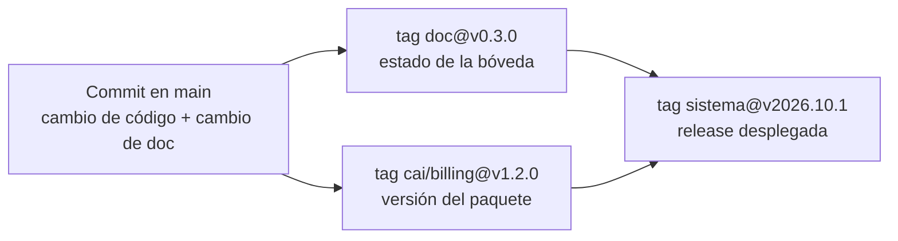

# Versionado de la Documentación

> [!info] Qué es este documento
> Define **cómo se versiona la bóveda**, que es distinta de cómo se versiona el
> código. El código se versiona por paquete con SemVer; la bóveda se versiona
> como un documento, con cortes que se nombran y se consultan.
>
> La diferencia importa: un tag `cai/billing@v1.2.0` dice "este módulo cambió";
> un tag `doc@v0.4.0` dice "este es el estado del conocimiento del proyecto en
> un momento".

---

## 1. Las cuatro capas de versión

| Capa | Qué versiona | Mecanismo | Visible para |
|---|---|---|---|
| **Paquete** | El código de cada módulo | SemVer por paquete (`cai/care@v1.2.0`) | El equipo |
| **Esquema** | La estructura de la base de datos | Indirecto: el esquema vive en las migraciones | El equipo |
| **Sistema** | El conjunto desplegado | Tag `sistema@vYYYY.MM.P` + manifiesto | Dirección y operación |
| **Documentación** ✅ | La bóveda | Tag `doc@vX.Y.Z` | Todos, incluidos Dirección y auditoría |

Las tres primeras están en [[06.01 Estrategia de Versionado]]. Esta cuarta es la
que se define aquí.

> [!important] Por qué la bóveda necesita su propia versión
> El resto del proyecto asume que "el código está versionado". Pero la bóveda
> es la fuente de verdad: si un documento cambia sin que quede rastro, **todo
> lo demás se apoya en una base que se movió**. Versionar la bóveda es
> cerrar esa puerta.

---

## 2. Esquema `doc@vX.Y.Z`

```
doc@vX.Y.Z
     │ │ └── parche: corrección, typo, enlace, frontmatter
     │ └──── menor: documento nuevo, decisión aceptada, cambio de proceso
     └────── mayor: cambio estructural (carpeta nueva, renumeración, esquema)
```

| Componente | Sube cuando… | Ejemplo |
|---|---|---|
| **X — mayor** | Cambia la **estructura** de la bóveda: se agrega o elimina una carpeta, se renumera, se cambia el esquema de nombres | Se crea la carpeta `12 - Registro de Cambios` |
| **Y — menor** | Se **agregan documentos** o se **acepta una decisión** que cambia lo que el proyecto hará | Se acepta ADR-0017; se agrega `12.01` |
| **Z — parche** | Se **corrige** lo existente sin cambiar su sentido: typos, enlaces, formato, `updated` | Se corrige un pipe sin escapar |

### 2.1 Reglas de la numeración

| Regla | Detalle |
|---|---|
| La numeración es **correlativa** y no se reutiliza | Un `doc@v0.3.0` que se revierte sigue existiendo |
| Un tag es **inmutable** | Nunca se mueve un tag a otro commit. Si algo salió mal, se publica `doc@v0.3.1` |
| Cada tag tiene un **mensaje** que explica el corte | `git tag -a doc@v0.3.0 -m "..."` |
| La versión vive también en el **índice** de este documento | Tabla de §5 |
| La versión se anuncia en el **registro** | Una entrada `REG` de tipo `decisión` o `proceso` |

### 2.2 ¿Minor o parche? El caso dudoso

| Situación | Versión |
|---|---|
| Se corrige un typo | Parche |
| Se reescribe una sección completa sin cambiar la decisión | Menor |
| Se reescribe una sección completa **cambiando** lo que se decidió | **Menor + ADR nuevo** |
| Se agrega un requisito no funcional | Menor |
| Se agrega un requisito funcional que bloquea una fase | **Menor + entrada en el backlog + ADR si cambia alcance** |
| Se actualiza un manual por un cambio de pantalla | Parche |

---

## 3. Qué dispara un corte de versión

Un corte de versión documental se hace cuando hay un **hito**, no cuando "se
terminó de escribir por hoy".

| Disparador | Motivo | Resultado |
|---|---|---|
| **Se cierra una fase del plan** (gate firmado) | Es el punto donde el proyecto avanza de verdad | `doc@vX.Y.Z` + entrada de registro |
| **Se acepta un ADR** | La decisión cambió; el histórico debe reflejarlo | `doc@vX.Y.Z` |
| **Se resuelve una pregunta abierta bloqueante** (P1, P2, P4…) | Desbloquea trabajo | `doc@vX.Y.Z` |
| **Se corta una release del sistema** | La documentación tiene que coincidir con lo desplegado | `doc@vX.Y.Z` + tag `sistema@vYYYY.MM.P` |
| **Cambio estructural de la bóveda** | Carpeta nueva, renumeración | `doc@vX+1.0.0` |

> [!note] Lo que NO dispara un corte
> Acumular documentos sin hito. Si nadie consultará esa versión, no vale el
> costo de sellarla. La granularidad excesiva en los tags vuelve el historial
> ilegible.

---

## 4. Relación con Git

La bóveda vive en el mismo repositorio que el código, en la carpeta
`sistema cai/`.

### 4.1 Correspondencia

| Objeto de Git | Objeto documental | Nota |
|---|---|---|
| Commit | Entrada de [[12.02 Registro de Cambios]] | Un commit, una entrada |
| Tag `doc@vX.Y.Z` | Versión documental | Punto de retorno de la bóveda |
| Tag `cai/<paquete>@v<version>` | Versión de un paquete | SemVer del código |
| Tag `sistema@vYYYY.MM.P` | Release desplegada | Manifiesto de versiones por paquete |
| Rama `main` | Estado vigente de la documentación | Siempre verde |

### 4.2 El tag documental y el tag de código son distintos



Una release del sistema puede tener **muchos** tags documentales dentro: la
documentación cambia más seguido que el código que se despliega.

### 4.3 Consultar una versión anterior

```bash
# Ver la bóveda tal como estaba en una versión
git checkout doc@v0.1.0 -- "sistema cai/"

# Ver un solo documento en su versión original
git show "doc@v0.1.0:sistema cai/11 - Decisiones ADR/ADR-0006 Cifrado de Notas Clínicas.md"

# Comparar dos versiones documentales
git diff doc@v0.1.0 doc@v0.2.0 -- "sistema cai/"

# Volver atrás sin perder el trabajo actual
git stash && git checkout doc@v0.1.0 && git stash pop
```

> [!danger] El error que hay que evitar
> `git reset --hard` o `git checkout .` para "volver atrás" destruye trabajo
> sin dejar rastro. Volver atrás se hace con `git checkout <tag> -- <ruta>` o
> con `git revert`. Ver [[12.01 Política de Cambios y Trazabilidad]] §9.

---

## 5. Versiones publicadas

| Versión | Fecha | Corte | Cambios principales |
|---|---|---|---|
| `doc@v0.1.0` | 2026-10-22 | Línea base | Bóveda inicial: 95 documentos, ADR-0001 … ADR-0010, 13 lotes temáticos |
| `doc@v0.2.0` | 2026-10-22 | Gobierno del cambio | Capa 12 completa (política, registro, bitácora, versionado), `AGENTS.md`, `05.07`, ADR-0017, control mecánico de permisos y hook de commit |

---

## 6. Retirar sin borrar

Cuando un documento deja de servir, **se retira, no se borra**:

| Paso | Acción |
|---|---|
| 1 | `status: deprecated` (obsoleto) o `status: superseded` (reemplazado) |
| 2 | Nota al principio del documento: qué lo sustituye y por qué |
| 3 | Se actualizan todos los wikilinks que apuntan a él |
| 4 | Se añade la entrada de registro de tipo `deprecación` |
| 5 | **El archivo permanece en el repositorio** y en la bóveda |

### 6.1 El patrón ya existe

La carpeta `98 - Antecedentes` es la que aplica este patrón: guarda el
[[ARQUITECTURA-SISTEMA-CAI (v1 - documento original)]] con `status:
superseded` y un aviso de precedencia. Un lector futuro que lo encuentre sabe
que existe, que fue superado y por qué.

### 6.2 Por qué no se borra

| Motivo | Detalle |
|---|---|
| **Auditoría** | "En la versión X el sistema tenía esta regla" debe ser verificable |
| **Decisión** | Ver qué se pensaba antes evita repetir un error ya descartado |
| **Contexto** | Un documento retirado a menudo explica por qué el actual es como es |
| **Reversión** | Si el sustituto falla, el original sigue ahí |

---

## 7. Reglas de los tags documentales

| Regla | Detalle |
|---|---|
| Prefijo fijo `doc@` | Distingue el tag documental del de paquete (`cai/...`) y del de sistema (`sistema@`) |
| Anotado, nunca ligero | `git tag -a` con mensaje. Un tag ligero no dice qué contiene |
| Nunca se mueve ni se borra | Si salió mal, se publica una versión nueva |
| El mensaje dice qué cambió | No "v0.2.0" sino "Gobernanza del cambio y ADR-0017" |
| Se taggea desde `main` | La versión documental refleja el estado vigente |
| La lista vive en §5 de este documento | Para no depender de `git tag` para saber qué hay |

---

## 8. Reglas de versionado de la bóveda

### 8.1 Reglas

| Regla | Detalle |
|---|---|
| **Todo documento tiene `updated`** | La fecha real de la última modificación, no la de creación |
| **Todo documento tiene `status`** | `borrador` · `vigente` · `deprecated` · `superseded` |
| **Los ADR no se editan una vez aceptados** | Se sustituyen por uno nuevo (ver [[Índice de ADRs]]) |
| **El índice es parte del documento** | Un documento nuevo que no está en el índice no existe para el lector |
| **Un cambio que invalida otro documento actualiza ambos** | En el mismo commit, no en otro día |

### 8.2 El índice como contrato de navegación

Con 100+ documentos, la única forma de que la bóveda siga navegable es que
**cada carpeta tenga un índice y cada índice esté actualizado**:

| Carpeta | Índice | Regla |
|---|---|---|
| `00 - Inicio` | [[Inicio]] | Actualizado en cada versión |
| `11 - Decisiones ADR` | [[Índice de ADRs]] | Actualizado en cada versión |
| `12 - Registro de Cambios` | Este documento y [[12.03 Bitácora de Sesiones con IA]] | Actualizado en cada versión |
| Resto | El propio `Inicio.md` | Actualizado en cada versión |

> [!tip] Por qué esto es una regla de escalabilidad
> Si un documento nuevo no se agrega al índice, el índice queda viejo y el
> documento queda invisible. Ese es el modo típico de fallo de una bóveda
> grande: no por falta de contenido, sino por falta de índice. La regla
> "documento sin índice no existe" convierte la navegación en una **condición
> de completitud**, no en una buena intención.

---

## 9. Relación con el versionado del código

| Pregunta | Respuesta |
|---|---|
| ¿La bóveda y el código se versionan juntos? | Sí, comparten repositorio, pero **tags distintos** |
| ¿Cada commit de código cambia la bóveda? | No. Solo si cambia lo que el sistema hace (ver [[05.07 Gobierno del Cambio]] §4) |
| ¿El número de versión de la bóveda tiene que coincidir con el del sistema? | No. La bóveda cambia más seguido |
| ¿Qué versión de la bóveda corresponde a una release? | La última anterior al tag `sistema@` |

### 9.1 Manifiesto de release

Cada release del sistema publica un manifiesto que dice qué se desplegó y con
qué documentación:

```yaml
release: sistema@v2026.11.1
fecha: 2026-11-15
documentacion: doc@v0.6.0
paquetes:
  core: 1.0.0
  identity: 1.1.0
  students: 1.0.0
  scheduling: 1.0.0
  care: 1.0.0
  billing: 1.0.0
  documents: 1.0.0
  notifications: 1.0.0
  reporting: 1.0.0
```

---

## 10. Documentos relacionados

- [[12.01 Política de Cambios y Trazabilidad]] — las reglas que exigen el versionado
- [[12.02 Registro de Cambios]] — el historial por cambio
- [[12.03 Bitácora de Sesiones con IA]] — la atribución por sesión
- [[06.01 Estrategia de Versionado]] — las otras tres capas
- [[06.05 Release y Deploy]] — cómo se corta una release
- [[ADR-0004 Trunk-based con Tags SemVer]] — la decisión de fondo
- [[ADR-0017 Registro y Trazabilidad de Cambios]] — por qué existe esta capa
- [[00.01 Convenciones de la Vault]] — la numeración y el frontmatter
