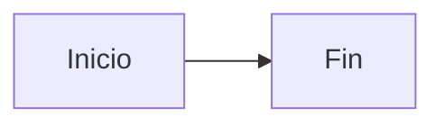

# Plantilla - Documento

> [!info] Cómo usar esta plantilla
> Copiar el contenido de este documento, renombrarlo con el formato `NN.MM Título.md` y
> eliminar este bloque de instrucciones.
>
> **Reglas:**
> - El `title` del frontmatter debe coincidir con el nombre del archivo.
> - Las tablas, listas y bloques de código deben conservar la sangría de Markdown
>   correcta (2 espacios dentro de las tablas).
> - Los wikilinks van **sin extensión**: `[[Otro Documento]]`.

---

```markdown
---
title: Título del documento
type: <tipo según 00.01 §3>
status: borrador
tags: [cai, <area>, <tema>]
owner: <rol responsable de mantenerlo>
updated: YYYY-MM-DD
related:
  - "[[Documento Relacionado 1]]"
  - "[[Documento Relacionado 2]]"
---

# Título del documento

> [!info] Resumen en una o dos frases
> Qué es este documento y por qué existe. Si el lector solo lee esto, ya debe saber
> de qué se trata.

---

## 1. Objetivo

Qué resuelve o qué documenta.

## 2. Alcance

### 2.1 Incluido

- ...

### 2.2 Excluido

- ...

## 3. Desarrollo

### 3.1 Subtema

Contenido, con tablas y diagramas donde ayuden.



## 4. Reglas

| Regla | Detalle |
|---|---|
| R-001 | ... |

## 5. Ejemplo

```php
// Código de ejemplo
```

## 6. Consecuencias

Qué se logra o qué se habilita con este documento.

## 7. Referencias

- [[Documento Relacionado 1]]
- [[Documento Relacionado 2]]

## 8. Registro de cambios

| Fecha | Cambio | Autor |
|---|---|---|
| YYYY-MM-DD | Versión inicial | ... |
```

---

## Los bloques de llamada disponibles

En Obsidian, los bloques de admonición se escriben así:

```markdown
> [!info] Título
> Contenido.

> [!note] Título
> Contenido.

> [!tip] Título
> Contenido.

> [!warning] Título
> Contenido.

> [!danger] Título
> Contenido.

> [!success] Título
> Contenido.

> [!example] Título
> Contenido.

> [!question] Título
> Contenido.
```

| Bloque | Cuándo usarlo |
|---|---|
| `[!info]` | Información neutral, contexto |
| `[!note]` | Aclaración complementaria |
| `[!tip]` | Recomendación práctica |
| `[!warning]` | Precaución importante |
| `[!danger]` | Riesgo real, algo que puede causar daño |
| `[!success]` | Condición cumplida, resultado |
| `[!example]` | Ejemplo concreto |
| `[!question]` | Pregunta abierta |

> [!tip] El bloque `[!danger]` es el más valioso
> Usado con criterio, marca los puntos donde alguien puede meter la pata. En la
> bóveda del CAI, un `[!danger]` suele marcar: una línea roja de seguridad, un
> error que ya se cometió, o un procedimiento donde el orden importa.

---

## La checklist antes de publicar

```text
☐ El frontmatter tiene todos los campos obligatorios
☐ El título del frontmatter coincide con el nombre del archivo
☐ El nombre del archivo sigue el formato NN.MM Título.md
☐ Los wikilinks resuelven (no hay destinos rotos)
☐ No hay caracteres extraños (CJK, cirílico) en el texto
☐ Las tablas tienen el formato correcto
☐ Los bloques de código tienen el lenguaje indicado
☐ La sección de referencias lista los documentos relacionados
☐ El documento es legible por alguien que no lo escribió
```

---

## Documentos relacionados

- [[00.01 Convenciones de la Vault]]
- [[Plantilla - ADR]]
- [[Plantilla - Fase del Plan]]
- [[Plantilla - Requisito Funcional]]
